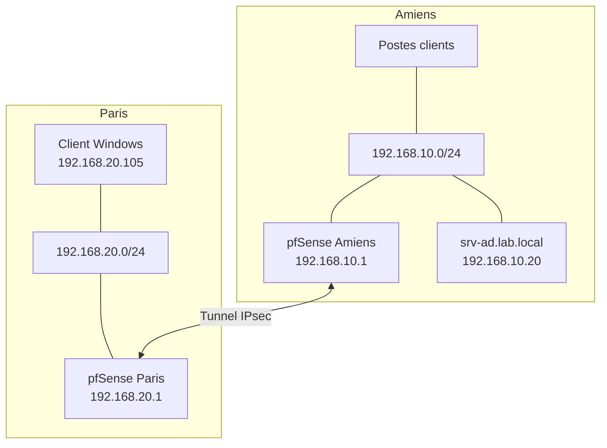

# 01 — Architecture réseau

## 1. Contexte

Le laboratoire représente une entreprise disposant de deux implantations géographiques : Amiens et Paris. Chaque site possède un réseau local distinct, connecté à un pare-feu pfSense. Les deux pare-feu établissent un tunnel VPN IPsec site-à-site afin de permettre les communications privées entre les sous-réseaux.

Le site d'Amiens héberge les services centraux d'annuaire et de résolution de noms. Le site de Paris héberge un poste client Windows qui rejoint le domaine et accède aux ressources centralisées.

## 2. Topologie

## 3. Plan d'adressage

| Site / équipement | Adresse |
|---|---|
| Réseau Amiens | `192.168.10.0/24` |
| Passerelle Amiens | `192.168.10.1` |
| Serveur AD/DNS | `192.168.10.20/24` |
| Réseau Paris | `192.168.20.0/24` |
| Passerelle Paris | `192.168.20.1` |
| Client Windows Paris | `192.168.20.105` (adresse relevée pendant les tests) |

Les deux réseaux LAN sont distincts et utilisent chacun un préfixe `/24`, soit le masque `255.255.255.0`.

## 4. Rôles des équipements

- **pfSense Amiens :** passerelle du LAN Amiens, filtrage et terminaison du VPN.
- **pfSense Paris :** passerelle du LAN Paris, service DHCP du site et terminaison du VPN.
- **srv-ad :** contrôleur de domaine et serveur DNS du domaine `lab.local`.
- **Client Windows Paris :** poste membre du domaine, utilisant les services AD/DNS d'Amiens.

## 5. Flux fonctionnels attendus

- Le client Paris doit pouvoir joindre la passerelle locale `192.168.20.1`.
- Le client Paris doit pouvoir atteindre le serveur `192.168.10.20` à travers le VPN.
- La résolution DNS du domaine `lab.local` doit être effectuée par le DNS AD `192.168.10.20`.
- Les ressources SMB du serveur doivent être accessibles depuis Paris si les règles de pare-feu et les autorisations le permettent.

## 6. Éléments à compléter

Ajouter depuis la configuration réelle :
- les réseaux WAN ou de transit utilisés par les deux pfSense ;
- les versions de pfSense et de Windows Server ;
- le type de virtualisation et les modes réseau des cartes virtuelles ;
- un schéma détaillé des interfaces WAN/LAN/IPsec ;
- les éventuels autres réseaux ou VLAN, s'ils existent.

Ne pas publier les adresses publiques, secrets ou identifiants de connexion.
